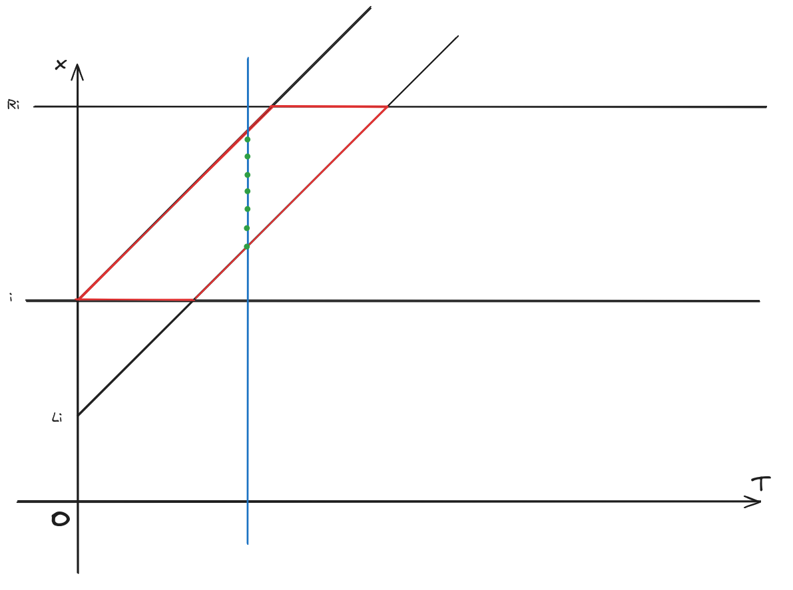
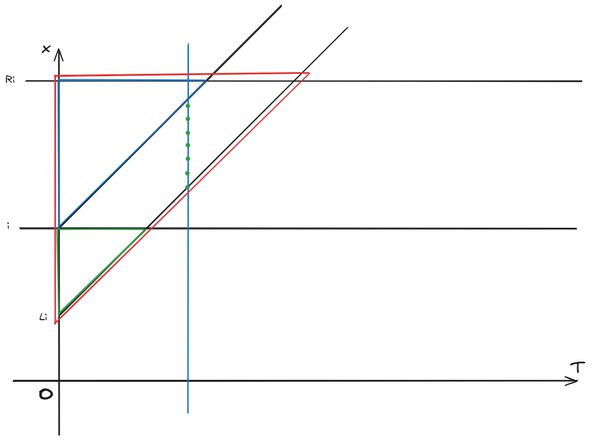

{/* truncate */}
## 题解
### 题意
给定一个长为 $N$ 的序列 $S_i$，刚开始为时刻 $0$。

定义 $t$ 时刻第 $i$ 个数为 $S_i(t)$，那么：

$$
\begin{cases}
        S_0(t)=0\\S_i(0)=S_i\\S_i(t)=\max\{S_{i-1}(t-1),S_i(t-1)\} 
\end{cases}
$$

你将对 $Q$ 个操作进行评估，第 $j$ 个操作让时刻 $T_j$ 时的区间 $[L_j,R_j]$ 全部变为 $0$。

执行一个操作需要一定的代价，执行第 $j$ 个操作需要以下的代价：

$$\sum\limits_{k=L_j}^{R_j}S_k(T_j)$$

求每个操作需要的代价。

注意：每个操作都是独立的。

对于 $100\%$ 的数据：

- $1 \le N \le 2 \times 10^5$。
- $1 \le Q \le 2 \times 10^5$。
- $1 \le S_i \le 10^9$。
- $1 \le T_j \le N$。
- $1 \le L_j \le R_j \le N$。

### 解法

以此题解，纪念我$OI$生涯中写的第一道黑题

首先，我们要进行的第一个转化是很显然的,我们注意这个式子。

$$
S_i(t)=\max\{S_{i-1}(t-1),S_i(t-1)\}
$$

我们显然是没法直接模拟这个过程的，但是我们很容易想到这个式子其实等价于。

$$
S_i(t)=\max_{i-t\leq j \leq i}\{S_j\}
$$

然后我们发现我们的询问是求一个区间和。

那么我们就可以通过差分的方式把询问改成一个前缀信息。

虽然目前我们不知道有什么用处，但总之前缀信息是比区间信息更容易维护的。

这样我们的暴力做法就很显然了。

我们暴力计算所有$sum_{i,t}$

然后对于每个询问按$t$分组

我们就可以$O(1)$的计算出每个询问的答案。

这样我们预处理是$O(n^2)$的，但是询问是$O(n+q)$的。

那么我们的瓶颈在于暴力计算所有$sum_{i,t}$。

首先$t$这一维我们是很难去优化的。

于是我们考虑减少枚举整个序列的复杂度。

然后我们发现，我们很难去通过某种方式减少枚举的复杂度。

于是我们就应该想到，我们计算的是一个前缀的和，而且我们也能注意到，每个值会被贡献多次。

所以我们考虑记录每个值在$t$时刻贡献的次数。

那么我们考虑一个值在什么时候会产生贡献，显然是这个长度为$t+1$的区间内没有比这个数大的数。

所以我们可以预处理出每个数左边离得最近的比这个数更大的数的下标$L_i$和右边离得最近的比这个数大的数的下标$R_i$。

但我们需要注意存在相等的数的情况,我们可以令$R_i$表示右边离得最近大于等于这个数的数的下标，这样相等的数就不会重复贡献。

这个$L_i$和$R_i$可以用单调栈预处理出来。

然后我们就可以算出这个数可以贡献多少次了。

我们只需要找到多少个右端点$x$满足。

$$
L_i < x-T \leq i \leq x < R_i
$$

也就是
$$
\begin{cases}
i \leq x < R_i\\
L_i+T < x \leq i+T
\end{cases}
$$

本人自己想到此处就已经燃尽了~~那不是太区了？~~

我们的主要瓶颈在于，随着$T$的变化，下面这个式子所对应的集合也在变化，而我们要取两个集合的交集，并求出元素的数量。

**我们发现这是一个偏序的条件，那么既然是偏序的条件，我们就应该考虑把这个条件放在坐标轴上思考**。

这是本题最大的启发。

那么我们考虑我们的偏序虽然只有一维，但是存在一个变量$T$，我们考虑建立一个横轴为$T$，纵轴为$x$的坐标轴。



那么我们发现，可能成为贡献的点集就在标红的平行四边形里

然后假设我们固定一个$T$（如图中蓝线）那么我们可以选的点就是图中绿点。

对了，我图画错了，按照前面的式子，这个斜线的下边界是取不到的，上边界能取。

然后我们考虑如何记录每个$T$对应的值。

这里还有一个小技巧，就是我们发现我们可以把平行四边形差分成三个三角形。



就是图中的红，绿，蓝三个三角形。

由于这都是等腰三角形，我们可以直接用纵轴的两个坐标来描述这三个三角形。

分别是$(R_i,i),(R_i,L_i),(i,L_i)$

然而我们要求的是$sum_{X,t}$

也就是说我们的$x$还要再满足一个条件$x \leq X$

以下，我们用$(l,r)$表示一个三角形

那么首先，当$t \geq r-l$的时候此时是取不到任何端点的，此时这个三角形是无效的。

我们只考虑$t<r-l$时。

此时这个三角形上端点为$r-1$，下端点为$l+t+1$因为我们注意是取不到$r$和$l+t$的。

那么可选的点数就是$r-1-(l+t+1)+1$，可是我们还要考虑一个上界$X$的情况。

一种方法是直接分类讨论，

当$X \geq r$时，点数为$r-1-(l+t+1)+1$

当$l+t < X < r$时，点数为$X-(l+t+1)+1$

当$X \leq l+t$时，点数为$0$。

写成一个式子就是$min(r-1,X)-min(l+t+1,X+1)+1$

但是我们发现想要维护这个式子有点困难。

而第二种方法是相当于直接差分。

$$
X-(l+t+1)+1=X-l-t
$$

表示$X$到$l+t+1$能取的点数。

$$
X-r+1
$$

表示$X$到$r$能取的点数。

而$l+t+1$到$r-1$能取的点数就是上式减下式，只不过要对$0$取$max$

$$
    \max\{X-l-t,0\}+\max\{X-r+1,0\}
$$

那么只有$l < X-t$的时候，上式第一项有贡献为$X-l-t$。

当$r<X+1$的时候，上式第二项有贡献为$X-r+1$

那么所有三角形的总贡献为

$$
    (X-t)\sum_{l< X-t} w-\sum_{l<X-t}lw-(X+1)\sum_{r<X+1} w+ \sum_{r<X+1} rw
$$

其中$w$表示这个三角形每个可选点会对总答案产生的贡献，

即三角形$(R_i,L_i)$的贡献为$s_i$

三角形$(R_i,i)$的贡献为$-s_i$

因为当$t\geq r-l$时，三角形时无效的，所以我们从小到大枚举$t$的时候

再$t$时删除所有$r-l=t$的三角形。

然后我们发现我们的式子就是四个前缀和，可以用树状树组动态维护。

那么这个题就做完了。

总时间复杂度为$O((n+q) \log (n+q))$

### 代码
<details>
<summary>code</summary>
```cpp
#include<bits/stdc++.h>
using namespace std;
using ll=long long; 
const int N=1e6+10;
int n,q;
inline int lowbit(int x){return -x&x;}
ll s[N];
__int128 ans[N];
struct node{
    int l,r,id;
};
struct NODE{
    int l,r;
    __int128 w;   
};
vector<node> qq[N];
int L[N],R[N];
vector<int> v;
vector<NODE> tri[N];
// int tot;
__int128 c[N][4];
inline void add(int x,__int128 k,int flag)
{
    for(;x<=n+2;x+=lowbit(x)) c[x][flag]+=k;
}
inline __int128 ask(int x,int flag)
{
    __int128 ans=0;
    for(;x;x-=lowbit(x)) ans+=c[x][flag];
    return ans;
}
int main()
{
    // freopen("5.in","r",stdin);
    // freopen("5.out","w",stdout);
    ios::sync_with_stdio(false);
    cin.tie(nullptr);
    cin>>n>>q;
    for(int i=1;i<=n;i++) cin>>s[i];
    for(int i=1;i<=n;i++)
    {
        while(v.size()&&s[v.back()]<=s[i]) v.pop_back();
        if(v.size()) L[i]=v.back();
        else L[i]=-n;
        v.push_back(i);
    }
    v.clear();
    for(int i=n;i>=1;i--)
    {
        while(v.size()&&s[v.back()]<s[i]) v.pop_back();
        if(v.size()) R[i]=v.back();
        else R[i]=n+1;
        v.push_back(i);
    }
    // for(int i=1;i<=n;i++) cout<<L[i]<<' '<<R[i]<<'\n';
    for(int i=1;i<=q;i++)
    {
        int t,l,r;
        cin>>t>>l>>r;
        qq[t].push_back({l,r,i});
    }
    for(int i=1;i<=n;i++)
    {
        tri[R[i]-L[i]].push_back({L[i],R[i],s[i]});
        add(max(L[i]+1,1),s[i],0);
        add(max(L[i]+1,1),s[i]*L[i],1);
        add(R[i]+1,s[i],2);
        add(R[i]+1,s[i]*R[i],3);
        tri[R[i]-i].push_back({i,R[i],-s[i]});
        add(i+1,-s[i],0);
        add(i+1,-s[i]*i,1);
        add(R[i]+1,-s[i],2);
        add(R[i]+1,-s[i]*R[i],3);
        tri[i-L[i]].push_back({L[i],i,-s[i]});
        add(max(L[i]+1,1),-s[i],0);
        add(max(L[i]+1,1),-s[i]*L[i],1);
        add(i+1,-s[i],2);
        add(i+1,-s[i]*i,3);
    }
    for(int T=0;T<=n;T++)
    {
        for(int i=0;i<tri[T].size();i++)
        {
            add(max(tri[T][i].l+1,1),-tri[T][i].w,0);
            add(max(tri[T][i].l+1,1),-tri[T][i].w*tri[T][i].l,1);
            add(tri[T][i].r+1,-tri[T][i].w,2);
            add(tri[T][i].r+1,-tri[T][i].w*tri[T][i].r,3);
        }
        for(int i=0;i<qq[T].size();i++)
        {
            int l=qq[T][i].l-1,r=qq[T][i].r;
            ans[qq[T][i].id]-=ask(max(l-T,1),0)*__int128(l-T)-ask(max(l-T,1),1)-__int128(l+1)*ask(l+1,2)+ask(l+1,3);
            // cout<<ans[qq[T][i].id]<<'\n';
            ans[qq[T][i].id]+=ask(max(r-T,1),0)*__int128(r-T)-ask(max(r-T,1),1)-__int128(r+1)*ask(r+1,2)+ask(r+1,3);
            // cout<<ans[qq[T][i].id]<<'\n';
        }
    }
    for(int i=1;i<=q;i++)
    {
        ll anss=ans[i];
        cout<<anss<<'\n';
    }
    return 0;
}
```
</details>


