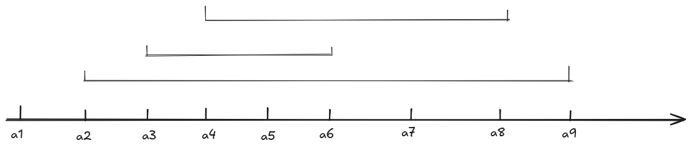
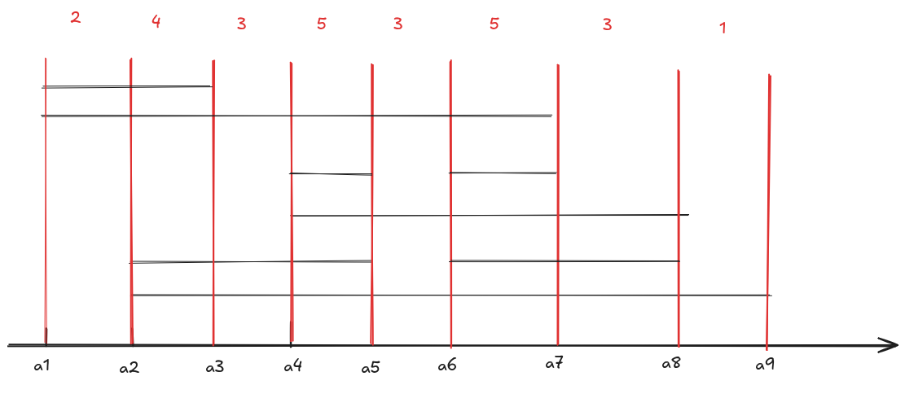
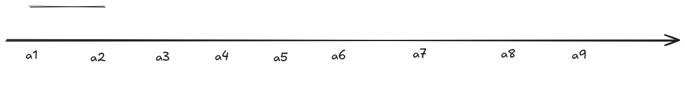
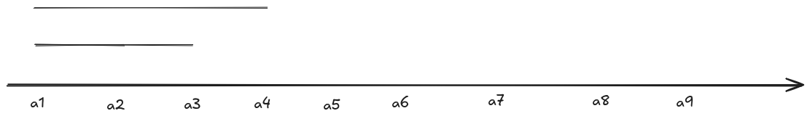

{/* truncate */}

## 一，介绍
连续段DP，是一种动态规划DP的技巧。通常运用于当你的记录需要与**相邻的节点权值**相关的时候。

主要技巧是，将状态设计中加入一维$j$，表示将原序列分成$j$个独立段，注意，这里段和段之间是有顺序的。

这样，在我们转移的时候，加入一个节点$i$，通常有三种转移方式。

- $1$. 独立成一个段。
- $2$. 放入已有的某个段的左端或右端。
- $3$. 连接两个已有的段。

接下来，我来讲一些例题。

## 二，例题

### $1$.Magneti

[原题链接](https://www.luogu.com.cn/problem/P7967)

对于这个题目，我们每次考虑放入一个磁铁时，我们方案是否合法都与放入这个磁铁的位置相邻的项的权值相关。

遇到这种模型时，就应该想到连续段$DP$的处理方式。

我们设计状态$f_{i,j,k}$表示，我们放前$i$个磁铁，分成$j$个连续段，总占用$k$个位置的方案数。

那么我们就可以考虑连续段$DP$的经典转移了。

考虑让$i$这个磁铁单独成段。

只会占用$1$格，而这一段可以放在之前任何连续段之间的空隙和两端

于是可以写出转移方程

$$
f_{i,j,k}=f_{i-1,j-1,k-1} \cdot j
$$

第二种转移，考虑将这个磁铁放在原来某个连续段的两端。

此时我们会找到连续段$DP$很多时候会遇到的问题。

考虑在某个连续段两端的转移。

很多连续段$DP$的难度就在于这个地方。

比如这个题，我们发现，当我们要把磁铁放在某个连续段的两端时，我们难以统计这个磁铁会占多少位置，因为要把它放在某个连续段的两端，我们需要满足一个限制。
$$
d \geq max(r_i,r_x)
$$
其中$r_x$是某个连续段的某个端点的吸引半径。

我们是无法维护每个连续段两端的权值的，所以我们需要找到一种办法干掉这个限制。

这个题的方式很简单。

我们只需要把所有磁铁从小到大排序，这样每次我们加入新磁铁时，$r_i$一定是当前最大的

那么我们的限制就直接变成了$d \geq r_i$与连续段两端的半径无关。

那么我们很快就能写出第二个转移方程。
$$
f_{i,j,k}=f_{i-1,j,k-r[i]} \cdot 2 \cdot j
$$
因为我们有$j$个连续段，每个连续段可以加入左端或右端$2$个位置。

第三个连接两个连续段的方程也能推出来了。

$$
f_{i,j,k}=f_{i-1,j+1,k-(2r_i -1) \cdot j}
$$
因为我们连接连续段只能连接相邻的，所以$j+1$个连续段一共$j$个空隙。

最后，我们统计答案时，只能有一个连续段，还会有$l-k$个空位没有使用，这些空位可以用插板法分配下去。

那么我们这道题就做完了。

下面是通过的代码。

<details>
<summary>code</summary>
```cpp
#include<bits/stdc++.h>
using namespace std;
using ll=long long;
const ll mod=1e9+7;
const int N=55;
int n,l;
int r[N];
ll f[N][N][11000];
ll jc[11000],inv[11000],jc_inv[11000];
inline ll c(int n,int m){return jc[n]*jc_inv[n-m]%mod*jc_inv[m]%mod;}
int main()
{
    ios::sync_with_stdio(false);
    cin.tie(nullptr);
    cin>>n>>l;
    for(int i=1;i<=n;i++) cin>>r[i];
    sort(r+1,r+n+1);
    f[0][0][0]=1;
    jc[0]=jc[1]=1;
    inv[0]=0,inv[1]=1;
    jc_inv[0]=jc_inv[1]=1;
    for(ll i=2;i<=l;i++)
    {
        jc[i]=jc[i-1]*i%mod;
        inv[i]=(-1ll*(mod/i)%mod*inv[mod%i]%mod+mod)%mod;
        jc_inv[i]=jc_inv[i-1]*inv[i]%mod;
    }
    for(int i=1;i<=n;i++)
    {
        for(int j=1;j<=i;j++)
        {
            for(int k=1;k<=l;k++)
            {
                f[i][j][k]=f[i-1][j-1][k-1]*j%mod;
                if(k>=r[i]) f[i][j][k]=(f[i][j][k]+f[i-1][j][k-r[i]]*2ll*j%mod)%mod;
                if(k>=(2*r[i]-1)) f[i][j][k]=(f[i][j][k]+f[i-1][j+1][k-(2*r[i]-1)]*j%mod)%mod;
            }
        }
    }
    ll ans=0;
    for(int k=1;k<=l;k++)
    {
        ans=(ans+f[n][1][k]*c(l-k+n,n)%mod)%mod;
    }
    cout<<ans<<'\n';
    return 0;
}
```
</details>

注意判断边界情况。

### $2$.摩天大楼

[原题链接](https://www.luogu.com.cn/problem/P9197)

这个题目看起来就更板子了，我们发现我们插入一个数时，我们需要知道将这个数与相邻数的差值计入状态。

然而，同样是上一道题的思维，我们需要考虑如何在不知道某个连续段端点项的权值时进行转移。

这个转化本人想了很久。

我们发现直接拆绝对值是不现实的，因为无论如何我们还是需要知道其他端点的权值。

所以我们考虑换一个维度去思考它。

我们把

$$
\sum_{1 \leq i < n} |a_{i+1}-a_i|
$$

放到一个数轴上看。



我们发现，每一个差值就是数轴上的一个区间，而每一个区间都可以由将$a$从小到大排序后的相邻数构成的区间拼接而成。

于是总的和我们就可以看成是这些区间贡献了每个区间的长度乘上这个区间被覆盖的次数。



如上图，这些区间可以看作是排列

$$
a_9,a_2,a_5,a_4,a_8,a_6,a_7,a_1,a_3
$$

产生的贡献。

那么虽然我们这样排列出来了，

但是还是无法解决我们一开始的问题。

当我们插入一个数的时候，我们要怎么计算这个数对总答案的贡献呢？

假设当前我们的排列是
$$
a_1,a_2
$$


这个线段$[a_1,a_2]$我们已经计算过了。

此时我们需要插入一个新的元素。

假设我们插入元素$a_3和a_4$，让排列变成
$$
a_3,a_1,a_2,a_4
$$


我们发现$[a_1,a_2]$段被计算了两次。

然后我们发现，此时我们再向这个排列中任意位置插如任意$>a_2$的数时，$[a_1,a_2]$都只会贡献两次。

这是为什么呢？

因为当我们考虑排列中只有$a_1$时，我们将$a_2$加入排列时，

如果$a_2$后面的元素都$>a_2$的话，那么无论把$a_2$放在什么位置，总会有另一个数$>a_2$的数放在$a_1$的另一侧，而这个贡献至少时$a_2-a_1$

于是我们相当于可以提前计算贡献。

我们把所有数按从小到大排序。

那么当我们要插入一个数$a_i$时。

这个数与上一个数的差值为$a_i-a_{i-1}$。

我们考虑把这个数插入到排列中。

一共有$2j$个位置放这个数。

而由于这$2j$个位置以后一定都会放一个比这个数要大的数，

那么这$2j$个位置至少会产生$2j \cdot (a_i-a_{i-1})$个贡献。

于是我们可以提前计算这个贡献，那么我们放入$a_i$的代价就是$2j \cdot (a_i-a_{i-1})$

可是这个时候就出现了一个问题，我们能算出这个代价的要求是，我们这$2j$个位置未来都会放数。

可是有可能第一个连续段的开头或者最后一个连续段的结尾不会再放数了。

于是我们再加入一维状态$l$表示有几个端点已经封了，已经封了的位置不会再插入新的数或者连续段。

那么接下来就是推导转移方程了，这里建议读者自己推导一遍,再根据参考代码核对。

下面是通过的代码
<details>
<summary>code</summary>
```cpp
#include<bits/stdc++.h>
using namespace std;
using ll=long long;
const ll mod=1e9+7;
const int N=1e2+10;
int n,m;
int a[N];
ll f[N][N][1100][3];
int main()
{
    ios::sync_with_stdio(false);
    cin.tie(nullptr);
    cin>>n>>m;
    for(int i=1;i<=n;i++) cin>>a[i];
    sort(a+1,a+n+1);
    if(n==1)
    {
        cout<<1<<'\n';
        return 0;
    }
    f[1][1][0][0]=1;
    f[1][1][0][1]=2;
    for(int i=2;i<=n;i++)
    {
        ll d=a[i]-a[i-1];
        for(ll j=1;j<=i;j++)
        {
            for(ll l=0;l<=2;l++)
            {
                for(int k=max(0ll,(2*(j-1)-l)*d);k<=m;k++)
                {
                    f[i][j][k][l]=(f[i-1][j-1][k-(2*(j-1)-l)*d][l]*(j-l)%mod)%mod;
                    if(j-1>=1&&l>=1&&k>=(2*(j-1)-(l-1))*d) f[i][j][k][l]=(f[i][j][k][l]+f[i-1][j-1][k-(2*(j-1)-(l-1))*d][l-1]*(3-l)%mod)%mod;
                    if(k>=(2*j-l)*d)
                    {
                        f[i][j][k][l]=(f[i][j][k][l]+f[i-1][j][k-(2*j-l)*d][l]*(2*j-l)%mod)%mod;
                        if(l>=1&&k>=(2*j-(l-1))*d) f[i][j][k][l]=(f[i][j][k][l]+f[i-1][j][k-(2*j-(l-1))*d][l-1]*(3-l)%mod)%mod;
                    } 
                    if(k>=(2*(j+1)-l)*d) f[i][j][k][l]=(f[i][j][k][l]+f[i-1][j+1][k-(2*(j+1)-l)*d][l]*j%mod)%mod;
                }    
            }
        }
    }
    ll ans=0;
    for(int i=0;i<=m;i++) ans=(ans+f[n][1][i][2])%mod;
    cout<<ans<<'\n';   
    return 0;
}
```
</details>

依旧注意边界情况。


